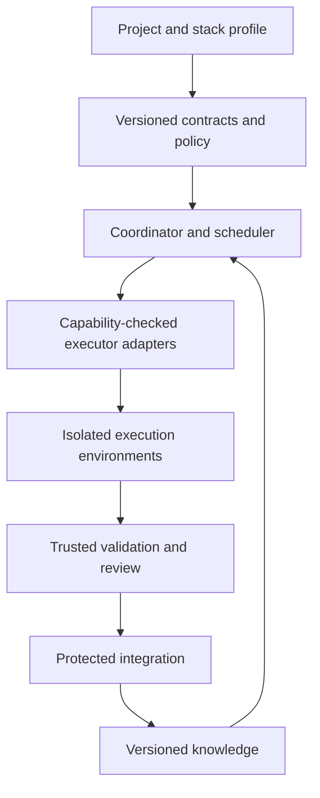

# Agent Workflow Harness

Portable contracts and preflight checks for AI-assisted software development.

[Português](README.pt-BR.md) · [Architecture](docs/architecture.md) · [Roadmap](docs/roadmap.md) · [Contributing](CONTRIBUTING.md)

Build development workflows around explicit tasks, versioned knowledge, scoped
execution, independent verification, and controlled integration. Keep those
contracts when changing projects, models, or agent tools.

## Status: early prototype

**Implemented:** JSON Schemas, a local validation CLI, cross-contract checks, an
example bundle, and automated tests.

**Not implemented:** a task server, transactional leases, agent execution,
filesystem sandboxing, a LangGraph runtime, RAG, MCP endpoints, provider adapters,
or a merge gateway. Validating a declaration does not prove that a runner enforces
it. This is not production security software and does not promise zero hallucinations.

## Try the validator

Python 3.11 or newer is required. Installation is from source; this repository is
not yet published to PyPI.

```sh
git clone https://github.com/tcalgarotto/agent-workflow-harness.git
cd agent-workflow-harness
python3 -m venv .venv
.venv/bin/python -m pip install -e '.[dev]'
.venv/bin/awh check examples/minimal
.venv/bin/awh validate task examples/minimal/task.json
.venv/bin/python -m unittest discover -s tests -v
```

On Windows, use `.venv\Scripts\python.exe` and `.venv\Scripts\awh.exe`.
Validation prints JSON and returns exit code 0 for success or 1 for invalid input.

## What the example demonstrates

A bundle contains `project.json`, `policy.json`, `adapter.json`, `task.json`, and
`workflow.json`. The checker rejects cross-project references, unauthorized tool
declarations, excessive budgets, incompatible declared capabilities, unsafe path
scopes, dependency cycles, and integration paths that bypass required gates.

Scopes use repository-relative files or directories ending in `/`; glob patterns
are intentionally unsupported. The example adapter is a declaration, not an
implemented agent connection. See [contract semantics](docs/contracts.md).

## Design



The diagram is the target architecture, not a list of completed features.
LangGraph, Langfuse, LangChain, search engines, and model providers are replaceable
integration points. MCP exposes tools; it does not replace authorization or a sandbox.

## Contribute

Start with [scope](docs/scope.md), [roadmap](docs/roadmap.md), and
[AGENTS.md](AGENTS.md). Propose a small change with observable acceptance criteria.
Do not claim provider compatibility until an adapter passes conformance tests.

Apache-2.0 licensed. Independent project; no affiliation with or endorsement by
the vendors referenced in the documentation.
