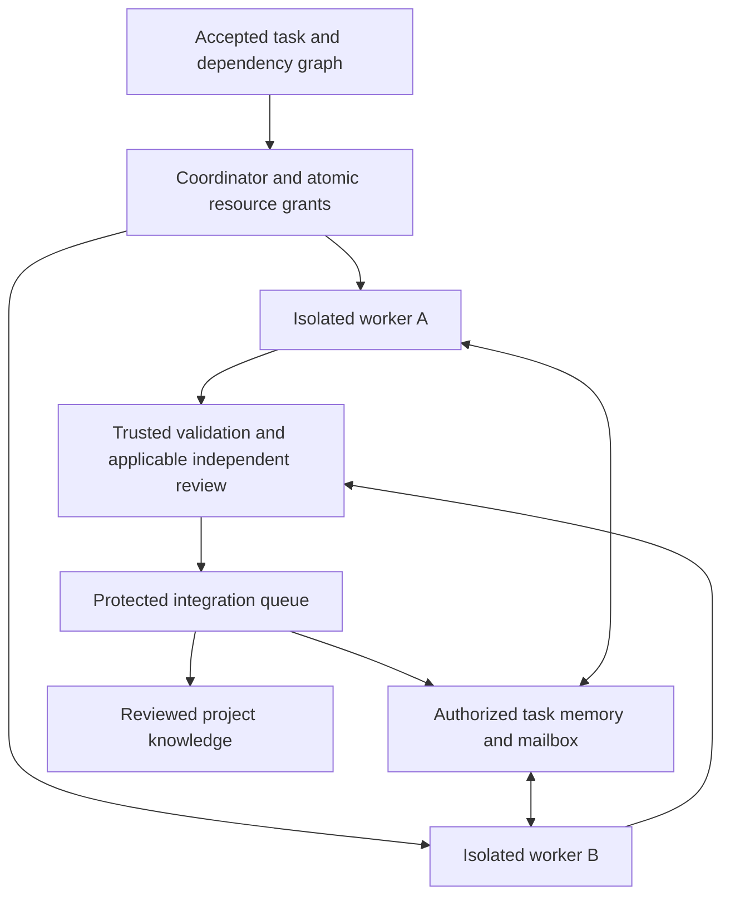

# Proposed development teams

Status: target-runtime design, not implemented by the contract validator. See
[ADR 0003](decisions/0003-portable-task-memory-and-development-teams.md) and the
[source review](research/2026-10-20-coding-teams-and-swarms.md).

## Choose a collaboration mode

| Mode | Appropriate use | Coordination |
|---|---|---|
| Bounded subtask | Search, analysis, a scoped change, independent review | Parent requests work; coordinator grants authority |
| Peer team | Participants need to exchange findings during related work | Shared task view and addressed messages |
| Scripted graph | Repeated procedure with known dependencies | Versioned graph with deterministic scheduling |

Default to one worker for small changes. For larger changes, use a coordinator
with a dependency graph, bounded parallel branches, and an integration queue.
Use debate or competing hypotheses for uncertain analysis; their conclusions
remain proposals. Majority voting cannot authorize writes, waive tests, or prove
correctness. Compare every added topology against a single-worker baseline.

Roles are independent of processes, models, platforms, and accounts. Three
available workers can rotate investigation, implementation, validation, and
review roles. They do not need a permanently running agent for each role.
Required independence concerns authority and execution identity, not just using
another model name. A coordinator role cannot manufacture integration permission.

## Bound delegation

Every governed child run needs a registered parent, task/contract revision,
identity, capability set, resource scopes, deadline, and budget reservation.
Child authority must be no broader than its parent's and the task's authority.
Reserve child budgets against a cumulative ancestor ledger; canceling, retrying,
or resuming cannot reset consumption. Bound depth, fan-out, outstanding messages,
retries, and active build/test processes as well as model calls.

Native child spawning must either be disabled or observable and constrained by
the adapter. A runner with ungoverned descendants cannot claim governed write
execution. Sandbox and gateway restrictions must apply to descendants even if
they ignore instructions. Native permission inheritance is not proof of this.

## Coordinate work and messages

The central task service owns dependencies, priority, claims, leases, and state
transitions. Native taskboards are views or sources of proposals. Reconcile them
against this authority; do not let two schedulers independently grant the same
resource. A dependency completing can make a task eligible, but only an atomic
claim grants it to a worker.

Use addressed, task-scoped messages with authenticated sender, permitted
recipient, message ID, correlation/parent IDs, relevant revisions, and artifact
references. Treat content as untrusted data. Messages cannot grant permissions,
change accepted requirements, or mark deliveries accepted. A request to change
scope must follow the normal contract update path.

Support duplicate delivery, deduplication, acknowledgements, bounded retries,
backpressure, and explicit causal references. Do not assume global message
ordering. Broadcast should be bounded and exceptional; send relevant findings
and immutable references instead of copying every participant's transcript.

Each worker receives the accepted [task memory](task-memory.md) view plus its
role-specific context. Its private reasoning/context is not a shared database.
Join and restart use a versioned snapshot and subsequent authorized events.

## Isolate changes and integrate deliberately

One active owner holds each conflicting write resource. Parallel read-only
investigations can overlap. Disjoint files can still share contracts, generated
outputs, caches, ports, databases, or build daemons; reserve or isolate those too.
Use per-run workspaces with actual OS/container restrictions and credentials.
Worktrees alone do not provide a security boundary.

An aggregator may summarize reports. Code integration requires candidate base
and commit identities, actual diff checks, current authority, conflict handling,
trusted validation, and applicable review. Serialize integration into a protected
branch and revalidate affected evidence when the base changes. Never concatenate
patches or treat a consensus summary as a verified combined change.

## Complete and recover

A worker or native goal evaluator can propose completion. The harness accepts a
delivery only after the task's revision-bound criteria and receipts pass. Time,
cost, and tool limits remain external controls, including across resumes. An
unavailable criterion produces an explicit unresolved result, not invented success.

Stopping a session is distinct from revoking its effects. Revoke expired authority
at gateways, reconcile ambiguous operations, and then decide whether to retry.
Preserve task history, cumulative budgets, message deduplication state, and
accepted revisions across restarts.

An optional control panel can display tasks, owners, budget usage, diffs,
messages, approvals, and failure evidence. Human actions use the same authorized
API. The core remains usable headlessly; opening more terminals is not an
orchestration or isolation guarantee.

## Acceptance before compatibility claims

Prove conflicting claims are rejected; native hidden children cannot escape
scope; retries do not duplicate effects; restart does not reset budgets; stale
messages cannot overwrite accepted decisions; and changed code invalidates
validation. Exercise a failed or disconnected teammate and a saturated reviewer
queue. Then repeat the same task contracts using two different real runners.
These are proposed acceptance cases, not completed runtime tests.

The [LangChain integration proposal](langchain-integration.md) maps this design to
bounded LangGraph branches and optional worker loops. Conversational handoff
and concurrent coding execution are separate capabilities; a swarm package name
does not establish the latter.
