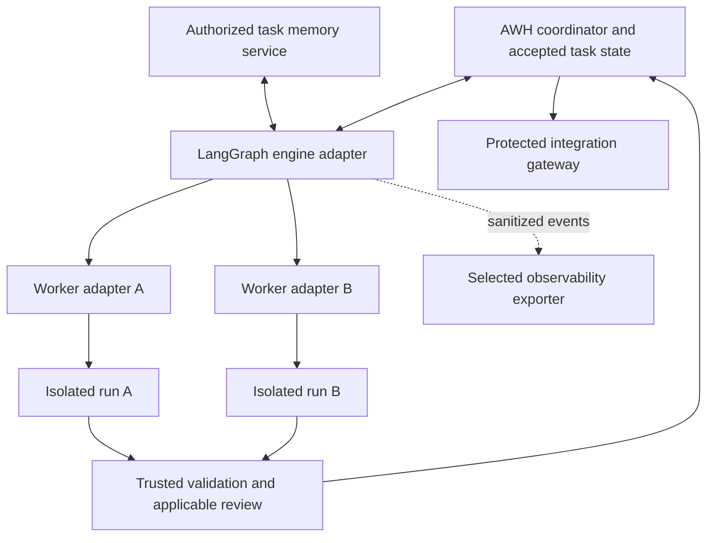

# Proposed LangChain ecosystem integration

Status: design proposal. No dependency, adapter, database, trace exporter, or
runtime is implemented by this document. See [ADR 0004](decisions/0004-langgraph-first-engine-adapter.md)
and the [source review](research/2026-10-20-langchain-ecosystem.md).

## Assign each component one job

The supplied image and the official build overview describe complementary
layers. They are not three independent schedulers to deploy together.

| Component | Proposed role | Adoption boundary |
|---|---|---|
| AWH core | Task authority, identities, leases, budgets, evidence, acceptance and integration | Remains independent of engine and worker implementations |
| LangGraph | First engine adapter candidate: explicit control flow, parallel branches, checkpoints and recovery | Must pass the core's conformance scenarios |
| LangChain | Selected model/tool interfaces, structured outputs, retrieval components and middleware | Use only needed packages; model support does not certify a coding runner |
| Deep Agents | Optional worker loop with planning, delegation and context management | Supply constrained tools and a verified execution backend |
| `langgraph-swarm` | Optional conversational handoff pattern | Not the default scheduler for concurrent coding tasks |
| LangSmith | Optional trace/evaluation destination and operator tooling | Export through an explicit data policy; not accepted task state |
| LangMem | Possible memory-extraction experiment mentioned in the engineering article | Generated memories remain proposals; excluded from the initial baseline |
| Provider/MCP integrations | Connect specific models, retrieval services and tools | Review exact versions, credentials, capabilities and effect semantics |

Native coding runners can remain executors behind the AWH adapter without being
wrapped as LangChain chat models. A provider API integration does not control an
IDE session, transfer subscription credentials, or establish a runner's isolation.
Keep native and API-driven execution paths distinguishable in capability reports.

Use the API documentation matching pinned packages. Historical benchmark examples
are not a dependency template for a new implementation. LangChain's integration
test suite can complement provider checks; it does not replace AWH's runner,
authorization, recovery and filesystem conformance tests.

## Engine boundary

The graph requests work through the coordinator. Only the coordinator can claim
resources, authorize a run, or accept a delivery. Engine state contains references
to accepted records, not independently mutable copies of authority.

Use explicit branches or `Send` for bounded parallel work. Register each child
with its own authority and cumulative budget reservation before execution. Graph
reducers combine workflow data; they do not merge code or resolve conflicting
accepted decisions. Prefer artifact references keyed by run and revision over a
single mutable transcript. Persist authoritative changes through typed core APIs.

LangChain retry, fallback, summarization, and call-limit middleware are useful
local controls. Apply additional cumulative accounting at the actual call/effect
boundaries. Retries consume budget; fallback must stay within the allowed model,
data destination, capability, and cost policy. A graph step limit is not a total
tool, token, process, or money limit. Summaries must retain evidence references
and uncertainty, without silently replacing accepted requirements.

## Persistence and shared memory

Keep these systems distinct even if a future deployment uses one PostgreSQL
installation with separate roles and schemas:

| System | Stores | Authority |
|---|---|---|
| Core coordination database | Task transitions, reservations, effect ledger, accepted decisions | Authoritative operational records |
| LangGraph checkpointer | Execution state for an engine thread | Progress and recovery, not permission |
| LangGraph Store or another memory adapter | Authorized cross-thread documents/projections | No stronger authority than the underlying source |
| Git and artifact storage | Reviewed requirements/code and immutable evidence | Exact revisions/hashes according to project policy |
| Search indexes and traces | Discovery and observations | Rebuildable/diagnostic, not task acceptance |

Map an opaque engine thread ID to an authenticated project/task/run in the core.
Do not accept arbitrary thread IDs or namespaces from a model as access grants.
Authorize reads, writes, enumeration, search and resume server-side. Cross-thread
memory needs an explicitly selected project/task namespace and expected-revision
updates for accepted records. Unrestricted `store.put` is not that acceptance API.

Use a persistent checkpointer for restart tests; in-memory examples lose state
when the process exits. Start durability experiments with `sync`, then measure
other modes against declared recovery requirements. A checkpoint is not an
atomic transaction with Git, a tool call, or an external service.

Keep credentials and reusable grants out of persisted graph state. Reacquire
short-lived authority through a broker. Checkpoints, offloaded tool outputs,
summaries and artifact stores all need access control and retention; deleting a
chat view does not establish deletion from those other locations.

## Recovery and approvals

Record effect intent and identity durably before shared writes; use an outbox or
equivalent reliable event publication at the core boundary. Route retries through
an idempotent effect gateway and reconcile ambiguous results before repeating.
If a service cannot safely deduplicate or expose the effect's outcome, stop that
automatic retry rather than claiming exactly-once behavior.

Interrupts can restart node code, and replay can execute later calls again.
Keeping an effect after an interrupt alone does not handle a subsequent crash.
Separate effectful operations, track their receipts, and recheck current leases,
scope and source revisions on resume. Time travel never restores old permissions
or rolls back already applied changes. Debug forks use fixtures/read-only access
unless a new authorized run is explicitly created.

Use interrupts only for unresolved decisions or approvals the existing project
policy requires. Authenticate the decision maker and validate the payload at the
service boundary; a resume value such as `approved: true` is not authorization.
Bind any approval to the relevant arguments, revisions and scope. A changed
request must follow that policy's validity rules, without asking again when
existing authorization still applies.

## Optional Deep Agents worker

Treat isolated subagent context and isolated filesystem/process access as separate
capabilities. The documented `LocalShellBackend` runs commands on the host without
a sandbox; it cannot establish our containment guarantees. Route governed coding
through a verified restricted runner. A filesystem routing or virtual-path option
does not restrict arbitrary shell commands.

Mount approved knowledge read-only, candidate changes in the run's workspace,
and temporary context in run-scoped storage. Expose knowledge changes through
proposal tools. Do not provide another writable path around accepted-memory APIs.
Children inherit restrictions and need visible run registration, even when the
library supplies delegation tools automatically. Test every supplied tool and
backend, including shared caches and external network effects.

## Observability and evaluation

Keep LangSmith and the existing Langfuse candidate behind an exporter interface.
Choose one initial destination after comparing required evaluation workflows,
data handling, hosting requirements and cost; using LangGraph does not require
choosing both. Managed deployment and visual tooling are separate adoption
decisions from using the open-source libraries.

Correlate project/task/run/parent IDs, effect IDs, contract revisions, adapter and
model versions, context manifests, actual usage and evidence references. Redact
or omit sensitive payloads before export and test nested tool data and metadata.
The SDK's secret anonymizer is an available safeguard, not proof every sensitive
value is detected. External export is opt-in; installing a package must not enable
it implicitly, including through inherited tracing environment settings. Do not
upload the original private project report or local logs.

Keep the mandatory effect/evidence ledger durable independently of a telemetry
backend. An exporter outage cannot turn a failed task into success; it also should
not block unrelated work unless the project's audit policy requires it. Use
sanitized, reviewed failures as evaluation fixtures, with held-out cases and
separate operational and outcome verdicts. Observed suggestions cannot directly
rewrite policy, prompts, accepted knowledge or evaluator expectations.

## Smallest useful experiment

First implement the coordinator and effect boundary. Then exercise one engine
adapter with synthetic workers, durable state and exact memory retrieval. Use
two independent tasks plus one deliberately conflicting resource; interrupt,
crash and resume the workflow. Add real runners only after these controls pass.
Compare a single worker, bounded graph parallelism and optional handoff on the
same coding fixtures. Record correctness, false acceptance, coordination/review
time, total calls/cost and unknown measurements, not just generated output.

Acceptance must reject foreign namespace access, stale resume/approval, budget
reset through a new child/thread, duplicate effects, unverified delivery and
scope escapes. Simulate a crash after an effect but before its graph checkpoint;
recover from the trusted ledger or expose unresolved state. Test memory conflicts,
trace redaction and exporter outage. Pin tested package/runner versions and
recheck conformance on upgrades. These are future tests, not executed results.

Runtime branching/delegation needs its own versioned protocol. Today's version-1
workflow schema is a static DAG and does not validate this execution design.
